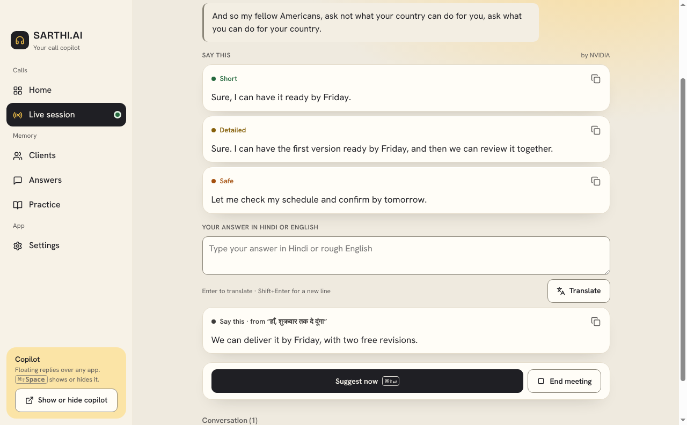

# SARTHI.AI

A live reply copilot for client calls on Mac. SARTHI listens to your call in
Google Meet, Zoom, Teams or any other app, and shows ready-to-say replies in
simple, natural English, using what it remembers about you and each client.



## What it does

- **Hears the call itself.** The client is heard through your Mac's sound
  output and you through the microphone, in any meeting app. No captions, no
  browser extension.
- **Speech to text on your Mac.** Whisper runs on the Mac: free, private, no
  key. Audio never leaves the computer. The model (about 80 MB) downloads once.
- **Three replies, automatically.** Short, Detailed and Safe (commits to
  nothing), about a second after the client pauses. Small talk ("okay",
  "thanks") is skipped. Press ⌘⇧↵ for replies any time.
- **Floating copilot.** A small window that stays above Meet or Zoom. ⌘⇧Space
  shows or hides it.
- **Answer in Hindi.** Type your answer in Hindi or rough English; it comes
  back as polished English to say.
- **Memory.** Notes per client, your profile, prepared answers for common
  questions, and a summary of every session.
- **Phrases to practise** after every session.
- **Your choice of AI.** Claude, Gemini, OpenAI or NVIDIA, with automatic
  fallback. Keys are encrypted with your Mac's Keychain.

## Requirements

- macOS 14.2 (Sonoma) or later to hear call audio. The app opens on macOS 13,
  but hearing the call needs 14.2+.
- An API key from one provider. NVIDIA (build.nvidia.com) and Gemini
  (aistudio.google.com) offer free keys for testing.

## Install

### Recommended: build it on your Mac

You need [Node.js](https://nodejs.org) 20 or newer.

```bash
git clone https://github.com/bhupit20/sarthi.ai.git
cd sarthi.ai
npm install
npm run dist:mac
```

The app is in `release/` (a `.dmg` and a `.zip` for Apple Silicon and Intel).
Open the `.dmg` and drag SARTHI.AI to Applications. Building on your Mac signs
the app for your computer, so it opens normally.

To try it without packaging: `npm start`.

### A build made elsewhere

An app built on another computer is not signed for yours, and macOS will
refuse to open it. After unzipping into Applications, run once in Terminal:

```bash
xattr -dr com.apple.quarantine /Applications/SARTHI.AI.app
codesign --force --deep --sign - /Applications/SARTHI.AI.app
```

## First run

1. **Settings → AI providers:** paste a key and press **Save key**, then
   **Test**. The first key is used for live replies and summaries.
2. **Settings → About you:** your work, prices and how you like to work.
3. **Home → Before your first call:** allow the microphone, allow call audio
   (System Settings → Privacy & Security → Screen & System Audio Recording →
   SARTHI.AI), and download the speech model.
4. **Answers:** add prepared answers for price, timeline and revisions.

## In a call

1. Join the call in Meet, Zoom or Teams.
2. In SARTHI, choose the client on **Home** and press **Start listening**.
3. The copilot appears. Replies show a moment after the client pauses.
4. Press **End meeting** when done. The summary and phrases to practise are
   saved under the client.

Tip: headphones give the cleanest transcript.

## Screen sharing

SARTHI asks macOS to keep its windows out of screen shares and recordings.
Electron documents that on macOS 15 and later, apps that capture with Apple's
ScreenCaptureKit (used by many meeting apps) can still capture such windows.
So:

- **Share a single window or tab** (safest): the copilot floats above it,
  unseen.
- **Sharing the entire screen:** test first by sharing with yourself.

## Privacy

- Audio is turned into text on your Mac. Only text is sent to the AI provider
  you chose, to get replies.
- Keys are encrypted with the macOS Keychain and never shown again.
- Clients, sessions and answers are stored only on your Mac.

## For developers

```bash
npm test              # unit tests
npm run typecheck
npm run build
xvfb-run -a npm run e2e   # the real app on a recorded voice (Linux); `npm run e2e` on a Mac
```

The end-to-end test needs Playwright available to Node (`npm i -g playwright`).
It plays `tests/fixtures/jfk-16k.wav` (public domain) as the client and checks
that it is transcribed and answered.

- `src/core`: logic shared with the Chrome extension (AI providers, prompts,
  session, memory) and the audio core (voice detector, echo filter).
- `src/main`: Electron main process (windows, Keychain, AI calls, call audio).
- `src/renderer`: dashboard, copilot, listening engine and speech worker.
- Plan: `docs/plan.md`. Design rules: `.ux-profile.md`.
